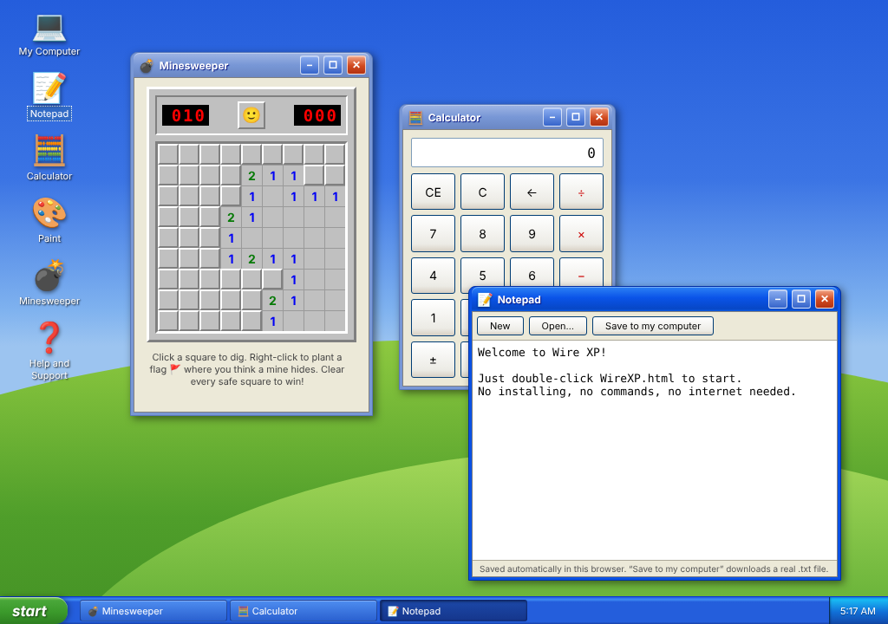

# Wire XP — a little computer in one file

Wire XP is a nostalgic, Windows XP-styled desktop that runs entirely inside **one single file**.
No installing. No commands. No ports. No internet needed. You just double-click it.

## How to start it (3 easy steps)

1. **Download it.** On this page, click the green **`<> Code`** button near the top, then click **Download ZIP**.
2. **Unpack it.** Find the downloaded ZIP file (usually in your *Downloads* folder), right-click it and choose **Extract All** (on Windows) or just double-click it (on Mac).
3. **Double-click `WireXP.html`.** That's it — it opens in your web browser and the computer "boots up".

> Tip: you can drag `WireXP.html` to your real desktop, a USB stick, or email it to a friend.
> It is completely self-contained and works the same everywhere, even without internet.

## What's inside

| Program | What it does |
|---|---|
| 📝 **Notepad** | Type notes. They're saved automatically, and you can download them as a real `.txt` file. |
| 🧮 **Calculator** | A simple calculator. |
| 🎨 **Paint** | Draw with 16 colors and save your picture as a real `.png` image. |
| 💣 **Minesweeper** | The classic game. Left-click to dig, right-click to plant a flag. |
| 💻 **My Computer** | Info about Wire XP. |
| ❓ **Help and Support** | A friendly guide to everything above. |

Plus the full experience: boot screen, login screen, draggable windows, a start menu,
a taskbar with a clock, and a proper "It is now safe to close this window" shutdown.

## Common questions

- **Do I need to install anything?** No. Your web browser (Edge, Chrome, Firefox, Safari — any of them) runs it.
- **Is it safe?** Yes. It's one ordinary HTML file. It doesn't connect to the internet or touch your other files.
- **Something looks stuck?** Press `F5` (reload) — that "restarts the computer". Your Notepad text survives restarts.
- **How do I turn it off?** Click **start → Turn Off Computer**, or simply close the browser tab.

---

*Wire XP is a loving homage to a classic desktop look. It is not affiliated with Microsoft.*

## Also in this repository

**[`harness-planner/`](harness-planner/)** — a wire-harness program planning
tool: data model, ingestion pipeline with confirmation checkpoints, rules
engine (BOM reconciliation, compatibility checks, accessory cascade, tooling
reuse), and generators for BOMs, termination maps, tooling lists, line plans,
costing with live-formula spreadsheets, make-vs-buy, procurement CSVs and
to-scale formboard drawings. See its [README](harness-planner/README.md).
